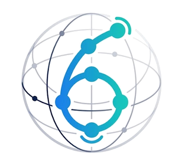

<p align="center"></p>

# Six Degrees of Wikipedia — plotter map

Name two Wikipedia topics. The app finds a chain of links connecting them, draws it as a map with extra branches hanging off each page, and exports an SVG (one layer per pen) ready for a pen plotter, or a JPG preview.

Everything runs in the browser against the public Wikipedia API. There is no build step and no backend.

## Run it

```bash
python3 -m http.server 8000
```

Then open <http://localhost:8000/>. Any static file server works. The live site is at <https://six.bobsabayesian.io>.

The only external dependency is [d3](https://d3js.org/) v7, loaded from a CDN, so you need an internet connection.

## Using it

1. **From / To** – type two topics (autocomplete suggests articles). Optionally press **+ Add via topic** to force the path through extra pages, in order.
2. **Find connection** – a bidirectional search looks for the connection (outgoing links from the start, incoming links to the end). The map grows live while it searches; **Stop** cancels.
3. Adjust the map, then **Download SVG** (for the plotter) or **Download JPG** (preview, with a width in pixels).

## Controls

The sidebar has four collapsible groups, **Map**, **Paper & style**, **Title** and **Pens**, each with a one-line summary on its heading (for example “Any link · 5 branches” or “A4 landscape · Simplex”). Which groups are open is remembered; on phones they all start closed. The download buttons stay pinned to the bottom of the sidebar.

| Panel | What it does |
|---|---|
| **Search** | Max expansions and frontier cap. Higher values find shorter paths but make more API requests. |
| **Strict mode** | Off by default. When on, every step of the path (not just the branches) may only use links a page offers under the Branches setting (turning it on sets that to the first 50 links of the infobox and main text). It reads each page's HTML, searches forward only, is slow, and gives up if there's no route within **Max jumps** (default 13; ~8 is a more realistic ceiling). |
| **Ignore list** | Pages to leave out (one per line, redirects like “NYT” resolved). Ignored pages never appear as branches and the search won't route through them. |
| **Branches** | Where branch links come from. The default, **Any link (fastest)**, samples at random from each page's links using Wikipedia's API. Or read each article's HTML for **infobox and main text** (N from each, so up to 2N), **main text only**, or **infobox only**, where “how many” is the first N, the first N %, or all, always in article order. The infobox (and side-bar boxes) count separately from the main text, so “first 3” of the main text starts at the lead's prose. Cross-links follow the same selection. Reading HTML is slower. Then branches per path node, per end node, sub-branches per branch, optional cross-links, and the layout seed (🎲). |
| **Paper & style** | Paper from postcard to A1 (plus Letter/Tabloid/custom), orientation, margin, node radii (ends vs. path vs. branches), font size, end-label scale, curved edges, node fill style (rings or hatching). |
| **Stroke font / wrapping** | Labels are drawn with single-stroke Hershey fonts so they plot as real pen lines. Separate wrap widths for satellite labels and path labels (0 = off; long titles are then truncated). |
| **Title** | Optional credit line (see [Licence](#licence)), optional title and subtitle (auto: “A to B”, “N degrees of separation”), top or bottom, alignment, size, font. |
| **Pens** | Define pens (colour + line width in mm), then assign one to every element: title, subtitle, start / end / via / path nodes and labels, branch and sub-branch nodes, edges and labels, cross-links, page border, and node fills (none by default). |

### Saving, examples and looks

- **Saved maps:** *Save map (.json)* stores everything: the settings, the path, the exact pages and their positions, your nudges and edits. SVGs exported here carry the same data inside their `<metadata>`, so an exported SVG doubles as a save file. Open either with *Open saved map…* or by dropping it anywhere on the page. Opening a saved map needs no Wikipedia lookups, and changing the paper, fonts, sizes or pens afterwards keeps the same pages (only the branch settings choose new ones).
- **Examples:** *Start from an example* loads a ready-made map (`starters/*.json`, made with this app, using the first links from each article's infobox and lead) so you can try everything before searching.
- **Looks:** the *Look* menu in Pens replaces the pens and the map style in one step (Classic, Minimal outline, Single pen with labels, Dense web, Bold and filled). It leaves the paper, title and topics alone.
- **Undo / Redo** (buttons, or Ctrl/Cmd+Z and Shift+Ctrl/Cmd+Z): covers looks, pen changes, dragging and nudging, label edits, ignoring a page and loading a map's edits. It doesn't cover running a new search.

### Editing the map

- **Drag** any node or label to nudge it. Click one and use the **arrow keys** (Shift = bigger steps). Double-click to reset it. Moving one item doesn't disturb the rest of the layout.
- **Keyboard and screen readers:** the *Edit page* menu above the map selects any page by name; then the arrow keys nudge it (Shift = bigger steps) and Esc closes the editor. Topic fields are accessible comboboxes (arrow keys and Enter pick a suggestion), the map has a text description, focus is always visible, and motion is reduced if your system asks for that. The page warns before you leave with unsaved edits.
- **Click** an element to open its edit bar: change the label text (Enter = new line), force 1/2/3 lines, scale text or node size, hide/show the label, or **Ignore page**.
- **On a phone or tablet** the map stays pinned at the top while you scroll through the settings below it, so changes show live. Drag nodes and labels with your finger; tapping one opens the edit bar as a bottom sheet with on-screen nudge buttons.
- Labels are automatically placed to avoid each other, node circles, edges, the title and the margins.

Nudges and per-element edits are cleared by a new search (and nudges by 🎲 / changing the seed), and are lost on reload unless you save the map first. Pen assignments and settings are saved in your browser's localStorage.

## Plotting

The SVG is in millimetres at the chosen paper size, with **one layer per pen**, named `1 Black`, `2 Red`, … — the naming Inkscape and the AxiDraw extension use for multi-pen plots. Layer order is pen order, and each layer carries the pen's colour and stroke width. Text is already stroke paths, so no text-to-path conversion is needed. Elements assigned to “— none —” are omitted.

## Notes and limits

- The path is close to shortest but not guaranteed to be: the search caps how many pages it expands per step and how much of a heavily linked page it reads. Raise **Frontier cap** / **Max expansions** to search harder.
- The path search itself still considers every link on every page (see below), so a path step can use a link outside your top N. Branches and cross-links use only the links you select.
- Branches are drawn from the articles' own link order, not from the alphabetical API list, so a heavily linked page isn't cut off at the end of the alphabet. The search itself still uses the API's link lists, which are capped (about 500 links per request, up to three requests shared across 20 pages), so hub pages can be partly truncated there.
- With via topics each leg is searched separately, so the total isn't guaranteed shortest through those stops.
- Wikipedia may rate-limit heavy use (HTTP 429). The app waits and retries; the log shows when it does.
- Label text is limited to basic ASCII for the stroke fonts. Accents are stripped (é → e) and a few characters are mapped (ø → o, – → -); other characters are dropped.

## Files

- `index.html`, `style.css` – the app interface.
- `six-about.html` – the About page (why this project exists, how to request a print).
- `app.js` – Wikipedia search, graph building, layout (d3-force), label placement, SVG rendering, UI.
- `fonts.js` – vendored Hershey single-stroke font data.
- `assets/` – logo and favicon.
- `LICENSE` – PolyForm Noncommercial 1.0.0.

## Licence

Licensed under the [PolyForm Noncommercial License 1.0.0](LICENSE). In plain terms: you may use, modify and share this software for **noncommercial** purposes (personal projects, hobby plotting, research, education, gifts). **Commercial use, including selling prints, SVGs or products made with it, or offering it as a paid service, needs a separate commercial licence.** To ask for one, open an issue at <https://github.com/bobsabayesian/six-degrees-wikipedia/issues>.

Maps you make for yourself are yours to plot and share. To help people trace where a map came from:

- Exports include a small **credit line** in the corner of the drawing (“Made with Six Degrees of Wikipedia - six.bobsabayesian.io”) and credit/licence **metadata** inside the SVG. The credit line is on by default and can be turned off in the Title panel for your own personal use. Please leave it on if you share or publish a map.
- Link data comes from Wikipedia, whose own licence ([CC BY-SA](https://creativecommons.org/licenses/by-sa/4.0/)) applies to its content.

## About / get a print

See [six-about.html](six-about.html) (linked from the app) for why this project exists and how to request a print through [Ko-fi](https://ko-fi.com/bobsabayesian).

## Credits

Hershey font data via the MIT-licensed [`hersheytext`](https://github.com/techninja/hersheytext) package (original Hershey data © US NBS, as redistributed by Evil Mad Scientist; these notices must be kept). Inspired by [wikipedia-map](https://github.com/controversial/wikipedia-map).
